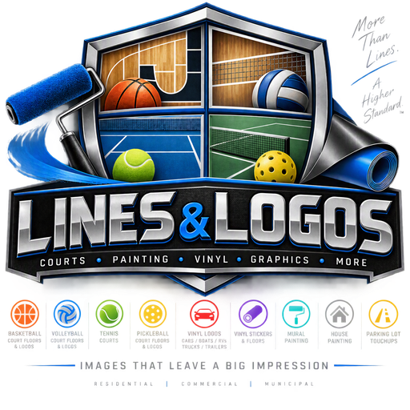

<p align="center">
  
</p>

<div align="center">


</div>

---

<div align="center">

<h1 align="center">Lines &amp; Logos</h1>

### ── Images that make a really BIG impression ──

Court floors and logos · Vinyl graphics · Murals and painting · Parking lot touchups

</div>

## Overview

Lines & Logos provides sports-court, vinyl, and painting services for customers looking to refresh, brand, or transform their spaces. This repository contains a sales pipeline dashboard designed to organize leads, estimates, project stages, and work tracking for the business.

## Services

### Sports Courts & Logos
- Basketball court floors and logos
- Volleyball court floors and logos
- Tennis courts
- Pickleball court floors and logos

### Vinyl Graphics & Floors
- Custom vinyl stickers
- Vinyl floors and floor graphics
- Vinyl logos for cars, boats, RVs, trucks, and trailers

### Painting & Property Touchups
- Mural painting
- House painting
- Parking lot touchups

## Sales Pipeline Dashboard

The dashboard supports day-to-day sales and job management, including:

- Lead capture and intake management
- Estimate tracking
- Sales pipeline and project-stage monitoring
- Deal progression and revenue visibility
- Work library management
- Sales-focused dashboard reporting

## Features

- Dashboard interface for business operations
- Lead and opportunity tracking
- Sales funnel visualizations
- Estimation workflows for service projects
- Responsive layout for desktop and mobile
- Branded workflows tailored to a surface-finishing business

## Technology

- TypeScript
- React
- CSS
- Taskade/Genesis app framework

## Quick Start

```bash
git clone https://github.com/ProjectZeroDays/lines-logos-sales-pipeline-dashboard.git
cd lines-logos-sales-pipeline-dashboard/apps/default
npm install
npm run dev
```

Open the local development URL shown in the terminal.

## Project Structure

```text
.
├── Logos/                 # Brand and logo assets
├── agents/
├── apps/
│   └── default/
│       ├── src/
│       ├── docs/
│       └── package.json
├── automations/
├── projects/
├── manifest.json
└── README.md
```

## Contact & Inquiries

For project estimates or inquiries, contact Lines & Logos through your preferred business contact channel with details about your court, flooring, vinyl graphics, painting, or touchup project.

---

<p align="center">
  <strong>Lines &amp; Logos</strong><br>
  Precision surfaces. Distinctive branding. Professional finish.
</p>
